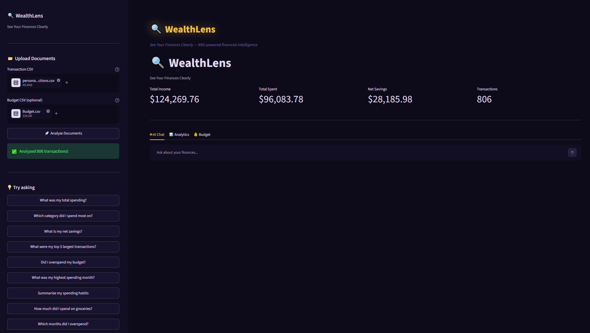
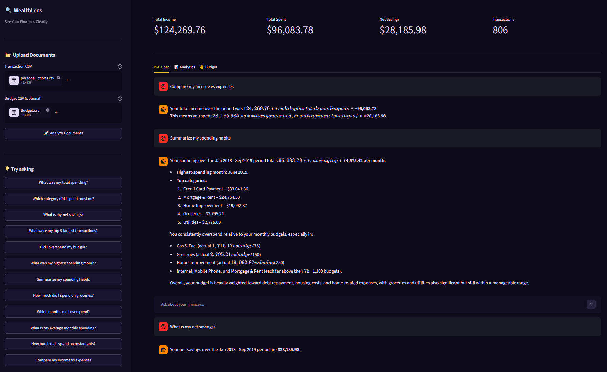
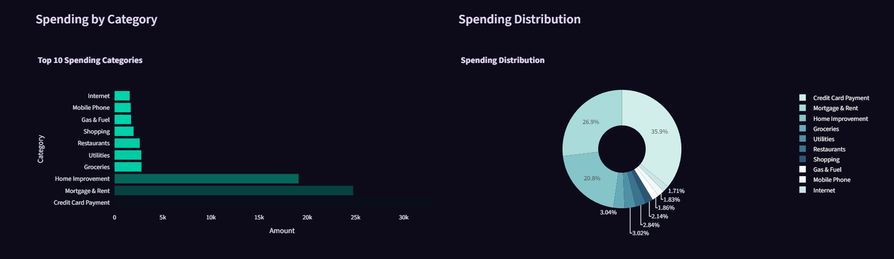
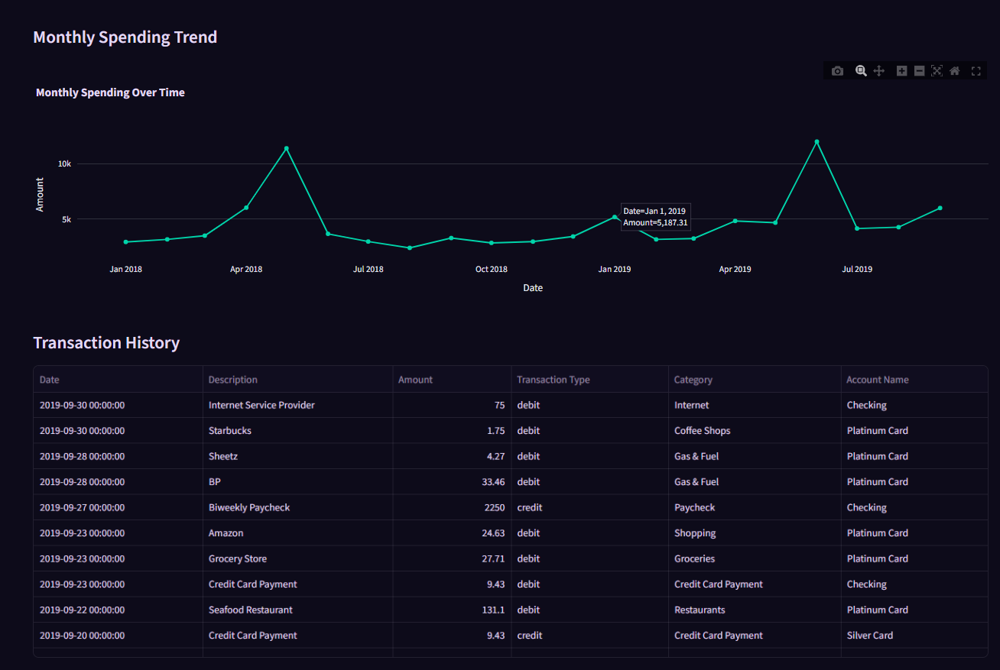
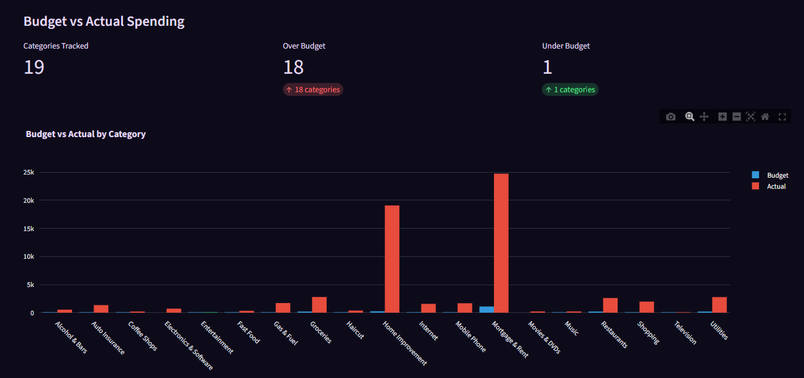
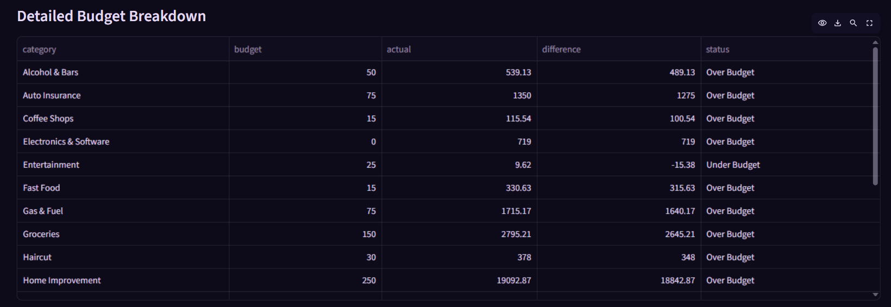

# 🔍 WealthLens — See Your Finances Clearly

> RAG-powered financial intelligence that understands your money and answers your questions in plain English.


---

## Demo








---

## What It Does

Upload your bank transaction CSV and ask anything in plain English:

- *"What was my total spending?"*
- *"Which category did I spend most on?"*
- *"What were my top 5 largest transactions?"*
- *"Did I overspend my budget?"*
- *"What was my highest spending month and why?"*
- *"Compare my income vs expenses"*

WealthLens retrieves the most relevant chunks from your financial data using FAISS vector search, then generates grounded answers using Groq + LLM — no hallucinations, no made-up numbers.

---

## Key Findings from Demo Data

| Question | Answer |
|----------|--------|
| Total income | $124,269.76 |
| Total spent | $96,083.78 |
| Net savings | $28,185.98 |
| Highest spending category | Credit Card Payment ($33,041.36) |
| Highest spending month | June 2019 |
| Biggest budget overrun | Groceries — over by $2,645.21 |
| Transactions analyzed | 806 |

---

## How It Works — RAG Pipeline

```
User uploads CSV/PDF
        ↓
Text extraction + chunking (500 token chunks, 50 overlap)
        ↓
Sentence Transformers embedding (all-MiniLM-L6-v2)
        ↓
FAISS vector store indexing
        ↓
User asks question → semantic similarity search (top 6 chunks)
        ↓
Retrieved context + question → Groq LLM
        ↓
Grounded answer with real numbers from your data
```

---

## Tech Stack

| Layer | Technology |
|-------|-----------|
| UI | Streamlit + custom CSS theme |
| RAG framework | LangChain |
| Vector store | FAISS |
| Embeddings | Sentence Transformers (all-MiniLM-L6-v2) |
| LLM | Groq API |
| Data processing | Pandas |
| Visualization | Plotly Express |
| Environment | python-dotenv |

---

## Project Structure

```
WealthLens/
├── app.py                      # Main Streamlit app
├── utils/
│   ├── financial_processor.py  # CSV loader + summary generator
│   ├── rag_engine.py           # FAISS vector store + RAG pipeline
│   └── __init__.py
├── screenshots/                # 6 demo screenshots
├── .streamlit/
│   └── config.toml             # Purple + gold theme
├── requirements.txt
└── .env                        # API key (not pushed)
```

---

## How to Run

**1. Clone the repo**
```bash
git clone https://github.com/aryzus/WealthLens.git
cd WealthLens
```

**2. Create virtual environment**
```bash
python -m venv venv
venv\Scripts\activate
```

**3. Install dependencies**
```bash
pip install -r requirements.txt
```

**4. Add your API key**
```
GROQ_API_KEY=your-groq-key-here
```
Get a free key at console.groq.com

**5. Run the app**
```bash
python -m streamlit run app.py
```

**6. Upload your data**
- Upload any bank transaction CSV
- Optional: upload a budget CSV
- Click "Analyze Documents"
- Start asking questions!

---

## Supported File Formats

| File | Columns needed |
|------|---------------|
| Transaction CSV | Date, Description, Amount, Transaction Type, Category, Account Name |
| Budget CSV | Category, Budget |

---

## Skills Demonstrated

- **RAG pipeline** — chunking, embedding, vector search, context injection
- **LangChain** — text splitting, FAISS integration
- **FAISS** — semantic similarity search over financial documents
- **Prompt engineering** — grounded financial Q&A, no hallucinations
- **Streamlit** — multi-tab UI with custom purple/gold theme
- **Pandas** — financial data processing, aggregation, budget comparison
- **Plotly** — spending charts, donut distribution, monthly trends
- **LLM API integration** — Groq API with context-aware responses

---

## Future Improvements

- PDF bank statement support via PyPDF
- Multi-document upload and cross-document queries
- Anomaly detection — flag unusual transactions automatically
- Export AI-generated financial report as PDF
- Support for multiple currencies
- Month-over-month comparison charts

---

*Built as a portfolio project demonstrating RAG-based document intelligence for personal finance.*
